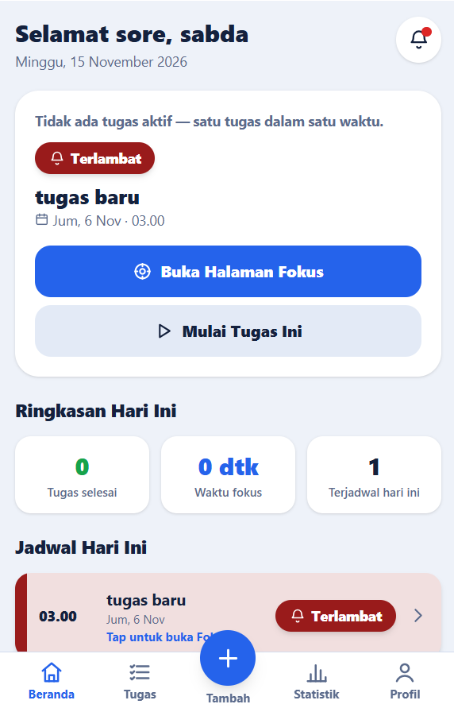
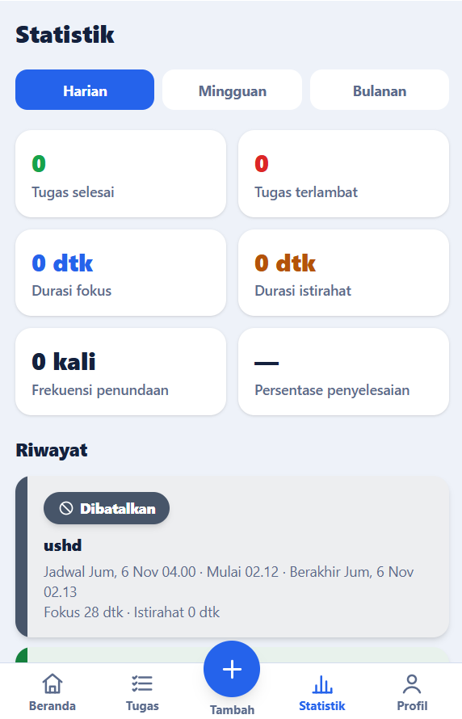
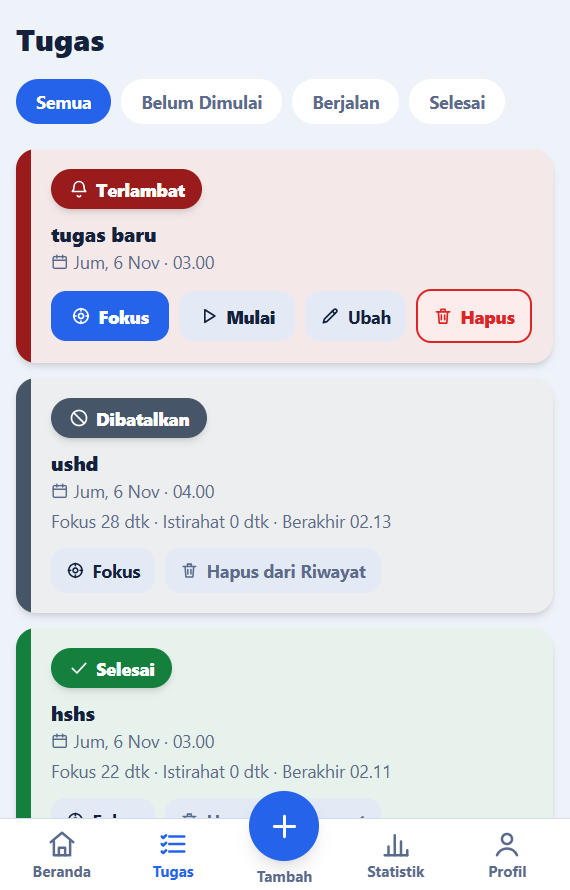

# Personal Life Todo List — Android

Aplikasi produktivitas untuk melawan kebiasaan menunda pekerjaan, dengan aturan One Task at a Time: pengguna hanya fokus pada satu tugas aktif. Tersedia sebagai aplikasi web dan aplikasi Android native, dengan alarm yang tetap berbunyi meski aplikasi ditutup.

  
  
  

## Fitur

📋 One Task at a Time — hanya satu tugas aktif, fokus tidak terpecah
⏰ Alarm Tugas — alarm berbunyi saat waktu mulai tugas tiba, dan berbunyi lagi setiap 30 menit jika tugas terlambat
🔔 Pengingat Fokus — pengingat setiap 30 menit selama tugas berjalan
☕ Istirahat — timer istirahat maksimal 15 menit, dengan alarm saat istirahat berakhir
🔁 Perulangan — tugas berulang harian, mingguan, atau bulanan
📅 Kalender Tugas — tap tanggal untuk melihat tugas hari itu
📊 Statistik — ringkasan tugas selesai, tugas terlambat, durasi fokus, dan durasi istirahat harian, mingguan, dan bulanan
📜 Riwayat — daftar tugas yang sudah selesai atau dibatalkan
🌙 Tema — terang, gelap, atau mengikuti sistem

## Teknologi

Kotlin · Jetpack Compose · Room Database · AlarmManager

## Cara Pakai

Buka proyek ini di Android Studio, lalu jalankan Gradle Sync dan Build > Build APK(s). Instal APK di HP Android, lalu buat tugas pertama dari tombol +.
